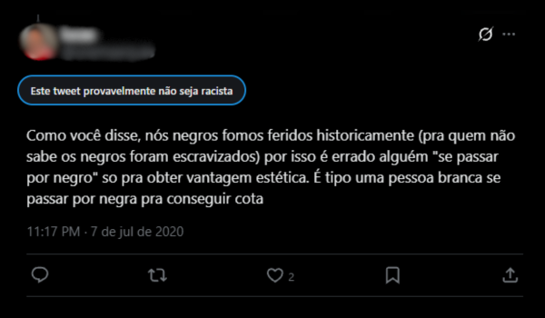

# 🛡️ Hateoff — Detecção de Discurso Racista no Twitter com Machine Learning

Extensão para navegadores Chromium integrada a uma API REST em Python que utiliza Processamento de Linguagem Natural (NLP) e Aprendizado de Máquina para identificar tweets com potencial conteúdo racista e auxiliar usuários na decisão de denúncia.

> 📄 **Projeto de TCC** desenvolvido no Instituto Federal da Bahia (IFBA – Campus Jacobina). O artigo completo está disponível em [`/docs/artigo-tcc.pdf`](./docs/artigo-tcc.pdf).

---

## 🎯 O Problema e o Impacto
O combate ao discurso de ódio racista nas redes sociais depende majoritariamente da denúncia feita pelos próprios usuários, mas muitas pessoas têm dúvidas sobre como identificar e reportar esse tipo de conteúdo. O **Hateoff** atua em tempo real na página do tweet, analisando o texto via Machine Learning e exibindo um alerta visual para apoiar a decisão de denúncia.

---

## 📸 Exemplos em Funcionamento

| Classificado como Racista | Classificado como Não Racista |
| :---: | :---: |
|  |  |
|  |  |

---

## 🏗️ Arquitetura da Solução

```text
[ Extensão Chromium (JS / HTML5 / CSS3) ]
                   │
                   │  1. Captura o texto do tweet e envia via GET
                   ▼
[ API REST em Python (Flask) ]
                   │
                   │  2. Pré-processamento (NLTK) + Classificação (Naive Bayes)
                   ▼
[ Resposta (0 = Não Racista | 1 = Racista) ]
                   │
                   │  3. Exibe alerta visual acima do tweet
                   ▼
[ Interface do Usuário no Twitter ]
```

---

## 📊 Dados e Modelo de Machine Learning
* **Base de Dados:** 875 tweets consolidados (319 classificados como racistas e 556 como não racistas), combinando bases acadêmicas em português (Fortuna et al., 2019; Leite et al., 2020) e coleta direta via API do Twitter com `Tweepy`.
* **Pré-processamento (NLP):** Normalização (`lower`), remoção de pontuação, tokenização (`word_tokenize`), remoção de *stopwords* em português e *stemming* (`RSLPStemmer`) utilizando **NLTK**.
* **Classificador:** Algoritmo **Naive Bayes (`GaussianNB`)** implementado com **Scikit-learn**.
* **Resultados:** Divisão de ~80% para treinamento (656 registros) e 20% para teste (219 registros), atingindo cerca de **72% de acurácia**.

---

## 🛠️ Tecnologias Utilizadas
* **Back-end & Machine Learning:** Python 3.10, Flask, Scikit-learn, NLTK, Tweepy
* **Extensão (Front-end):** JavaScript, HTML5, CSS3 (compatível com Chrome, Edge e Opera)
* **Dados:** CSV

---

## 📂 Estrutura do Repositório

```text
hateoff/
├── api/          # API REST em Flask, modelo de ML e requirements.txt
├── dataset/      # Base consolidada de tweets (.csv) e legenda
├── docs/         # Artigo completo do TCC (.pdf) e prints em assets/
├── extension/    # Código da extensão Chromium (manifest.json, JS, CSS e ícones)
└── README.md     # Documentação principal
```

---

## 🚀 Como Executar Localmente

### 1. Clone o repositório
```bash
git clone https://github.com/devgabrielbarreto/hateoff.git
cd hateoff
```

### 2. Inicie a API em Python
```bash
cd api
pip install -r requirements.txt
python server.py
```

### 3. Instale a extensão no navegador (Chromium)
1. Acesse `chrome://extensions/` (ou `edge://extensions/`).
2. Ative o **Modo do desenvolvedor** no canto superior direito.
3. Clique em **Carregar sem compactação** e selecione a pasta `extension/`.
4. Acesse a página de um tweet específico para visualizar a classificação em tempo real.

---

## 👥 Autores
* **Gabriel Oliveira Barreto** — [LinkedIn](https://www.linkedin.com/in/gabrielbarretodev/) | [GitHub](https://github.com/devgabrielbarreto)
* **Vitória Almeida Ramos**
* **Rebeca Barros** (Orientação – IFBA)
